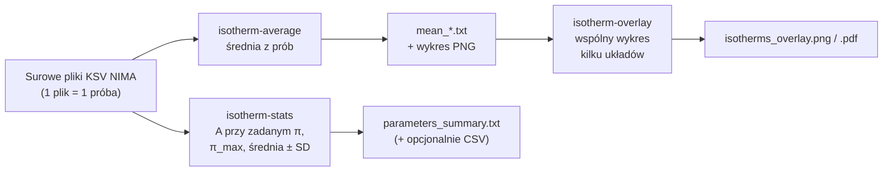

# langmuir-isotherm-tools

Zestaw trzech narzędzi wiersza poleceń do obróbki izoterm ściskania **π–A** monowarstw Langmuira, zapisanych w plikach tekstowych z programu **KSV NIMA**:

| Narzędzie | Co robi |
|---|---|
| `isotherm-average` | uśrednia kilka powtórzeń (prób) jednego układu do jednej izotermy |
| `isotherm-overlay` | nakłada kilka uśrednionych izoterm na wspólny wykres (bez dalszego uśredniania) |
| `isotherm-stats` | wyznacza z każdej próby powierzchnię przy zadanych ciśnieniach i ciśnienie maksymalne, podaje średnią ± SD |

Narzędzia powstały do analizy danych w pracy magisterskiej, ale są ogólne: nie zawierają żadnych danych ani ścieżek zależnych od użytkownika.

## Spis treści
1. [Pipeline](#pipeline)
2. [Instalacja](#instalacja)
3. [Dane wejściowe](#dane-wejściowe)
4. [Szybki start na danych demonstracyjnych](#szybki-start-na-danych-demonstracyjnych)
5. [Krok po kroku](#krok-po-kroku)
6. [Metodyka obliczeń](#metodyka-obliczeń)
7. [Ograniczenia i uwagi](#ograniczenia-i-uwagi)
8. [Rozwiązywanie problemów](#rozwiązywanie-problemów)
9. [Testy i struktura repozytorium](#testy-i-struktura-repozytorium)
10. [Licencja](#licencja)

## Pipeline



Typowy przebieg dla kilku układów (np. kontrola i układ z dodatkiem badanego związku):

1. dla **każdego układu** osobno: `isotherm-average` → plik `mean_<układ>.txt`,
2. dla **każdego układu** osobno: `isotherm-stats` → tabela parametrów,
3. pliki `mean_*.txt` wszystkich układów kopiujesz do jednego folderu i uruchamiasz `isotherm-overlay`.

## Instalacja

Wymagany jest Python 3.9 lub nowszy.

```bash
git clone https://github.com/<twoja-nazwa>/langmuir-isotherm-tools.git
cd langmuir-isotherm-tools
python -m venv .venv
# Windows:  .venv\Scripts\activate
# Linux/macOS:  source .venv/bin/activate
pip install -e .
```

Po instalacji w terminalu dostępne są polecenia `isotherm-average`, `isotherm-overlay` i `isotherm-stats`. Bez instalacji można je uruchamiać jako `python -m langmuir_isotherms.average ...` (po `pip install -r requirements.txt` i ustawieniu `PYTHONPATH=src`).

## Dane wejściowe

### Surowe pliki prób (wejście do `isotherm-average` i `isotherm-stats`)

* jeden plik `.txt` = jedna kompresja (jedna próba),
* kodowanie `latin-1`, kolumny rozdzielone tabulatorem, separator dziesiętny: przecinek lub kropka,
* plik musi zawierać wiersz nagłówka tabeli zaczynający się od `t[s]`; kolumny są rozpoznawane po **początku** nazwy: `Mma` (powierzchnia na cząsteczkę, Ų/cząsteczkę) i `P1` (ciśnienie powierzchniowe, mN/m, sonda 1). Inne nazwy kolumn można podać opcjami `--area-column` i `--pressure-column`,
* wiersze poniżej nagłówka, których nie da się odczytać jako liczby, są pomijane.

Zakładany układ plików to **jeden folder na jeden układ badawczy**, w którym leżą wyłącznie próby tego układu:

```
data/
├── kontrola/
│   ├── proba_1.txt
│   ├── proba_2.txt
│   └── proba_3.txt
└── genisteina_1proc/
    ├── proba_1.txt
    └── proba_2.txt
```

Pliki wynikowe (średnie, raporty) mogą leżeć w tym samym folderze: narzędzia pomijają pliki bez nagłówka `t[s]`.

### Pliki średnich (wejście do `isotherm-overlay`)

Pliki tekstowe tworzone przez `isotherm-average` o czterech kolumnach rozdzielonych tabulatorem:

```
A_A2    Pi_mean_mN_per_m    Pi_std_mN_per_m    n_trials
```

Czytnik wymaga tylko pierwszych dwóch kolumn (trzecia, odchylenie standardowe, jest opcjonalna), więc przyjmuje też pliki o innych nagłówkach.

## Szybki start na danych demonstracyjnych

Repozytorium zawiera generator sztucznych danych (bez sensu fizycznego), pozwalający wypróbować cały pipeline:

```bash
python examples/make_synthetic_data.py data_demo
mkdir data_demo/results

isotherm-average data_demo/control   -o mean_control   -n 3
isotherm-average data_demo/genistein -o mean_genistein -n 3
cp data_demo/control/mean_control.txt data_demo/genistein/mean_genistein.txt data_demo/results/

isotherm-overlay data_demo/results \
    --label mean_control "Kontrola" --label mean_genistein "Genisteina 1%" \
    --show-std --xlim 35 105 --invert-x

isotherm-stats data_demo/control --label "Kontrola" --csv per_trial.csv
```

(W PowerShellu zamiast `\` na końcu wiersza użyj znaku `` ` ``, a zamiast `cp` polecenia `copy`.)

## Krok po kroku

### 1. `isotherm-average`: średnia z kilku prób

```bash
isotherm-average <folder_z_probami> -o mean_<nazwa_ukladu> -n <liczba_prob>
```

Każda próba jest interpolowana liniowo na wspólną siatkę wartości A, a następnie liczona jest średnia i odchylenie standardowe w każdym punkcie siatki.

Wyniki zapisywane w folderze wejściowym:
* `<nazwa>.txt`: średnia izoterma w **pełnym** zakresie (przycinanie dotyczy tylko wykresu),
* `<nazwa>.png` (lub inne formaty): wykres prób i wypadkowej.

| Opcja | Znaczenie |
|---|---|
| `-o`, `--output-name` | nazwa plików wyjściowych (domyślnie `mean_isotherm`); warto użyć przedrostka `mean_` |
| `-n`, `--n-trials` | oczekiwana liczba prób; przy innej liczbie plików program kończy się błędem (zabezpieczenie przed pomyłką) |
| `--step` | krok siatki w Ų (domyślnie 0,1) |
| `--include-edges` | siatka obejmuje sumę zakresów prób, a nie tylko zakres wspólny |
| `--decimal {comma,point}` | separator dziesiętny w pliku wynikowym (domyślnie przecinek, wygodny dla polskiego Excela) |
| `--area-column`, `--pressure-column` | początek nazw kolumn (domyślnie `Mma` i `P1`) |
| `--crop-mean-only` | przytnij tylko wypadkową, próby rysuj w całości |

### 2. `isotherm-overlay`: wspólny wykres kilku układów

```bash
isotherm-overlay <folder_ze_srednimi> --label mean_kontrola "Kontrola" --label mean_g1 "Genisteina 1%"
```

Wczytuje pliki `mean_*.txt` z folderu (zmiana maski: `--pattern`), nakłada je na jeden wykres i niczego nie uśrednia.

| Opcja | Znaczenie |
|---|---|
| `--pattern` | maska nazw plików (domyślnie `mean_*.txt`) |
| `--exclude NAZWA ...` | pliki do pominięcia |
| `--label PLIK ETYKIETA` | podpis w legendzie (nazwa pliku bez `.txt`); można powtarzać |
| `--crop-file PLIK MIN MAX` | inne przycięcie dla jednej krzywej, np. `--crop-file mean_g1 40 none` |
| `--show-std` | półprzezroczysty pas ± odchylenie standardowe |
| `--colors`, `--linestyles`, `--linewidth` | wygląd krzywych |

### 3. `isotherm-stats`: parametry izotermy

```bash
isotherm-stats <folder_z_probami> --label "Kontrola" --pressures 30 32.5 35 --csv per_trial.csv
```

Dla **każdej próby osobno** wyznaczana jest powierzchnia na cząsteczkę przy zadanych ciśnieniach (`A30`, `A32.5`, `A35`) oraz maksymalne zarejestrowane ciśnienie `pi_max`. Następnie liczona jest średnia i odchylenie standardowe z prób.

Wyniki: `parameters_summary.txt` (tabela zbiorcza, wartości z poszczególnych prób, liczba poprawnych wyników) oraz opcjonalnie CSV.

### Opcje wykresów (wspólne dla `isotherm-average` i `isotherm-overlay`)

Dotyczą wyłącznie wyglądu wykresu, nie zmieniają danych zapisywanych do plików. Zakres podaje się jako `MIN MAX`, a brak ograniczenia jako `none`.

| Opcja | Przykład | Znaczenie |
|---|---|---|
| `--xlim` | `--xlim 25 85` | zakres osi X |
| `--ylim` | `--ylim 0 55` | zakres osi Y (domyślnie dopasowany do widocznych krzywych) |
| `--crop-x` | `--crop-x 33 none` | rysuj tylko dla A ≥ 33 Ų |
| `--invert-x` | | duże A po lewej, czyli kolejność kompresji |
| `--xlabel`, `--ylabel`, `--title` | | opisy osi i tytuł (domyślne etykiety są po polsku) |
| `--formats` | `--formats png pdf` | formaty zapisu |
| `--dpi`, `--figsize` | `--dpi 300 --figsize 8 5.5` | rozdzielczość i rozmiar |

## Metodyka obliczeń

* **Wczytanie próby.** Dane są sortowane rosnąco po A. Punkty o identycznym A są uśredniane. Wiersze nieliczbowe i wartości nieskończone są pomijane.
* **Średnia izoterma.** Każda próba jest interpolowana liniowo na siatkę o stałym kroku. Domyślnie używany jest tylko **zakres wspólny** wszystkich prób, dzięki czemu na brzegach nie powstają skoki wynikające z różnej liczby prób. Nie stosuje się ekstrapolacji.
* **Odchylenie standardowe.** Liczone jako odchylenie z próby (`ddof = 1`). Dla jednej próby nie jest określone (puste pole w pliku).
* **Powierzchnia przy zadanym ciśnieniu** A(π). Dla każdej próby punkty sortuje się według ciśnienia, uśrednia A dla powtarzających się wartości π i interpoluje liniowo. Jeśli próba nie osiągnęła zadanego ciśnienia, wynik ma wartość `n/a` (bez ekstrapolacji) i nie wchodzi do średniej.
* **`pi_max`.** Maksymalne zarejestrowane ciśnienie w próbie, **nie** zawsze ciśnienie załamania (kolapsu) monowarstwy. Jego wartość trzeba zweryfikować na wykresie.

## Ograniczenia i uwagi

* Format plików KSV NIMA został założony na podstawie przykładowych plików (nagłówek `t[s]`, kolumny `Mma` i `P1`). Inne wersje programu mogą mieć inny układ, wtedy użyj `--area-column` / `--pressure-column` lub zgłoś issue z kilkoma pierwszymi wierszami pliku.
* Dla zaszumionych, nierównomiernych danych interpolacja A(π) po sortowaniu według ciśnienia nie jest tym samym co pierwsze przekroczenie zadanego ciśnienia podczas kompresji. Przy wyraźnej histerezie lub szumie sprawdź wyniki na wykresie.
* Odchylenie standardowe z 2 lub 3 prób jest tylko orientacyjne. Podawaj liczbę prób obok wyniku.
* Nie publikuj w repozytorium niepublikowanych danych pomiarowych. Katalogi `data/` i `results/` są domyślnie ignorowane przez `.gitignore`.

## Rozwiązywanie problemów

| Komunikat / objaw | Przyczyna i rozwiązanie |
|---|---|
| `Folder not found` | błędna ścieżka; w Windows ujmij ścieżkę ze spacjami w cudzysłów |
| `header line starting with 't[s]' not found` | to nie jest surowy plik z KSV NIMA; przenieś inne pliki z folderu lub zmień `--pattern` |
| `no column starting with 'P1'` | plik ma inne nazwy kolumn; komunikat wypisuje dostępne, podaj właściwą w `--pressure-column` |
| `Expected 3 trial files, found 2` | liczba plików w folderze różni się od `-n`; sprawdź folder lub popraw `-n` |
| `The trials have no common area range` | próby nie nakładają się w zakresie A; użyj `--include-edges` lub sprawdź dane |
| Pusty wykres po `--crop-x` | przycięcie wyklucza wszystkie punkty; zmień zakres |
| Polskie znaki w legendzie jako kwadraty | czcionka wykresu nie ma polskich liter; zainstaluj czcionkę (np. DejaVu Sans) |

Dodatkowe informacje o przebiegu wypisuje opcja `-v`.

## Testy i struktura repozytorium

```bash
pip install -e ".[dev]"
pytest
```

Testy sprawdzają m.in. wczytywanie plików z przecinkiem dziesiętnym, wyniki na izotermach liniowych (znane rozwiązanie analityczne), zakresy wspólny i sumaryczny, obsługę błędów oraz cały pipeline od prób do raportu.

```
langmuir-isotherm-tools/
├── src/langmuir_isotherms/
│   ├── fileio.py       # wczytywanie i zapis plików
│   ├── processing.py   # średnia, A(π), statystyki
│   ├── plotting.py     # wspólne funkcje wykresów
│   ├── cli.py          # wspólne opcje wiersza poleceń
│   ├── average.py      # isotherm-average
│   ├── overlay.py      # isotherm-overlay
│   └── stats.py        # isotherm-stats
├── tests/
├── examples/make_synthetic_data.py
├── pyproject.toml
└── LICENSE
```

## Licencja

MIT. Szczegóły w pliku [LICENSE](LICENSE). Przed publikacją wpisz swoje imię i nazwisko w `LICENSE` oraz w `pyproject.toml`.
